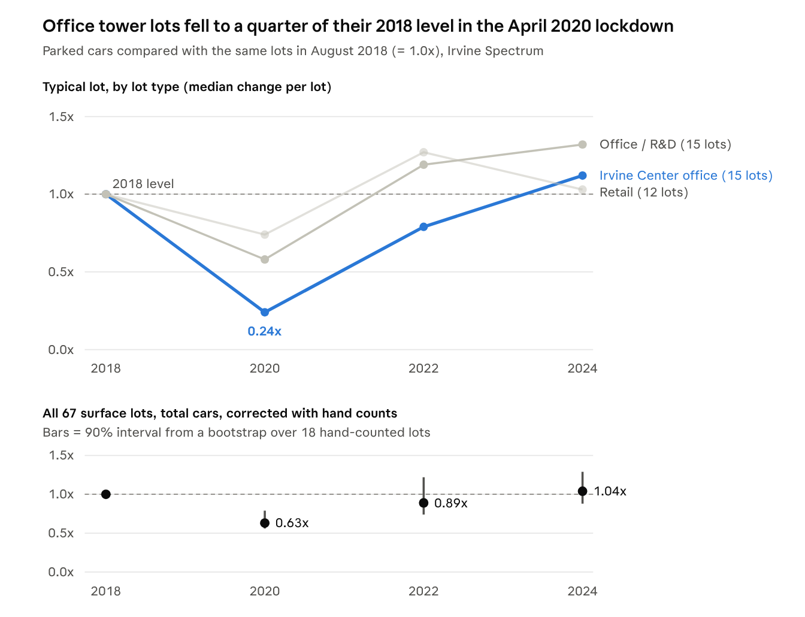

# Did COVID empty the parking lots?

A case study with `aerialdetect`: parked cars counted in public aerial photos before, during and after COVID,
with the detector fine-tuned and checked against blind hand counts.

## Summary

During California's April 2020 stay-at-home order, the parked cars around Irvine Spectrum fell to
**0.63x of their 2018 level** (90% interval 0.56–0.79x), and the typical lot fell to about half. Office tower
lots emptied most, to about a quarter of normal; retail lots fell least. By 2024 parking was back to its 2018
level.

Sacramento's mid-June 2020 imagery shows no clear dip. By then the city had partly reopened, and hand counts
agree with the model there.

The numbers come from USDA NAIP aerial photos (0.6 m per pixel) and a car detector fine-tuned on 2,526
hand-clicked cars. Checked against hand counts on lots it never trained on, its per-crop counts correlate at
r = 0.95–0.99 with the human ones.



*Fold-model ensemble at confidence 0.20, Irvine Spectrum, NAIP 2018–2024. 2016 is left out (June flight, one
anomalous lot; see [Limitations](#limitations)).*

## Question and study areas

The question is whether lockdown and remote work show up as emptier parking lots in free, public aerial photos.
NAIP flies each US state every two years, so a lot can be compared across years on the same kind of image.

An area works only if every flight is on a weekday in a similar season, and the lots have few trees over them.
Fifteen candidate areas were checked with `aerialdetect naip-dates`. Most failed on weekend or holiday flights,
or had no 2020 flight.

| Area | 2016 | 2018 | 2020 | 2022 | 2024 | Lots used |
| --- | --- | --- | --- | --- | --- | --- |
| Irvine Spectrum office parks (main) | Thu Jun 2 | Tue Aug 21 | Fri Apr 24 (lockdown) | Mon Apr 25 | Mon May 6 | 67 surface lots |
| Sacramento downtown + Midtown | Mon–Tue Jun 20–21 | Sat (not used) | Wed Jun 17 | Tue Jun 21 | Wed Jun 26 | 818 surface lots |

- **Tempe / ASU was dropped:** NAIP only photographs it in summer, when campus is empty anyway.
- **Sacramento was kept but is hard:** heavy tree shade hides cars from both the detector and human counters.
- **Irvine is the main area:** large open lots, low tree cover, and a 2020 flight in the middle of the
  stay-at-home order. 2018 is its baseline year.

## Method

Each lot's car count is compared across years, with the detector checked against blind human counts at every
step.

1. **Imagery:** NAIP RGB photos at 0.6 m per pixel, upsampled 3x to 0.2 m so a car is a few dozen pixels wide.
2. **Lots:** parking-lot outlines from OpenStreetMap, frozen as a file (`data/lots/`) so every year uses
   identical lots. Each lot is tagged with the city's zoning at its centre: office, retail, residential and
   so on.
3. **Detection:** a YOLO11s oriented-box model, pretrained on the DOTA aerial dataset, counts vehicles whose
   centre falls inside each lot.
4. **Blind hand counts:** a person clicked every visible car in 132 lot crops (33 lots across all years), with
   crop order shuffled so the year was hidden. That gave 2,526 clicks.
5. **Fine-tuning:** the clicks became training boxes, with everything outside the lot blacked out. Lots were
   split into three groups; three models each trained on two groups, so every lot is scored by a model that
   never saw it.
6. **Area-wide trend:** the three models' counts are averaged for every lot. Totals are then corrected year by
   year with the hand-count ratio, and a bootstrap over hand-counted lots gives the 90% interval.

## How accurate is the detector

Fine-tuning on the hand counts turned an unusable detector into one that tracks human counts closely, including
on lots it never saw.

| Detector, scored on lots it did not train on | Cars found (recall) | Detections that are real (precision) | Per-crop correlation with hand counts | Model ÷ hand count, range across years |
| --- | --- | --- | --- | --- |
| Irvine, off-the-shelf (conf 0.05) | 53% | 64% | 0.77 | 0.69–1.18 |
| Irvine, fine-tuned (conf 0.20) | 87% | 73% | 0.95 | 0.89–1.25 |
| Sacramento, off-the-shelf (conf 0.05) | 47% | 76% | 0.57 | 0.27–1.00 |
| Sacramento, fine-tuned (conf 0.20) | 80% | 79% | 0.95 | 0.92–1.10 |
| 6 extra Irvine lots, 2018 + 2020, fine-tuned | 78% | 78% | 0.99 | 0.99–1.02 |

- **The off-the-shelf detector could not be used:** it missed about half the cars, and how many it missed
  changed with each year's imagery. In Sacramento it found only 27% as many cars as people did in 2020.
- **Evening out brightness and colour between years did not help.** Histogram-matching every year to a
  reference year left accuracy unchanged; a per-image contrast stretch cut recall roughly in half.
- **The last row is the strongest check.** Those six lots were chosen because the models disagreed with the
  earlier sample, and were counted after training. The models' totals came within 2% of the hand totals in
  both years.

## Results: Irvine Spectrum

In the April 24, 2020 photos, total parked cars were 0.63x of 2018, and the typical lot was at 0.52x (median of
46 lots). Office lots emptied most.

| Compared with August 2018 | 2020 | 2022 | 2024 |
| --- | --- | --- | --- |
| All 67 surface lots, total (90% interval) | 0.63x (0.56–0.79) | 0.89x (0.74–1.22) | 1.04x (0.88–1.29) |
| Irvine Center office lots, median of 15 | 0.24x | 0.79x | 1.12x |
| Office / R&D lots, median of 15 | 0.58x | 1.19x | 1.32x |
| Retail lots, median of 12 | 0.74x | 1.27x | 1.03x |

Retail fell least, consistent with grocery and big-box stores staying open. Two lots were busier during
lockdown than in 2018, one retail and one office/R&D; the hand counts confirm both. By 2022 the typical lot was
back to its 2018 level.

## Results: Sacramento

Sacramento shows no lockdown dip in its June 17, 2020 photos; its low year is 2022. Its only pre-COVID weekday
flight is June 2016, so that is the baseline.

| Compared with June 2016 | 2020 | 2022 | 2024 |
| --- | --- | --- | --- |
| All 818 surface lots, total (90% interval) | 1.07x (0.95–1.27) | 0.83x (0.59–1.20) | 1.20x (1.02–1.45) |
| Typical lot (median of 206) | 0.80x | 0.56x | 0.92x |
| Downtown core lots (19) | 0.98x | 0.67x | 0.71x |
| 15 hand-counted lots, people's totals | 1.08x | 0.58x | 1.12x |

By mid-June 2020 Sacramento had partly reopened, so a flat 2020 is plausible; the hand counts, which do not
depend on the detector, show the same thing. Downtown, where state offices are, is the one area still below
2016 in 2024.

## Limitations

The Irvine lockdown drop is solid; finer year-to-year differences of 10–20% are within the noise.

- **One photo per year.** Each year is a single weekday flight, so a busy or quiet day moves that year's
  number. Fridays and Mondays (Irvine 2020, 2022, 2024) are lighter office days under hybrid work.
- **Season differs in Irvine.** Flights run from April to August. Offices are not strongly seasonal, but 2016
  (June) reads 1.4x of 2018 (August) and is left out of the before/after comparison.
- **One Irvine lot changed before COVID.** Lot 83 held 110 cars in 2016 and 3–19 in every later year, for
  reasons the imagery does not show.
- **Hidden cars are not counted.** People counted only cars at least half visible, and the detector learned the
  same rule, so cars under trees or in garages are missing in every year alike.
- **Lot outlines are from today.** OpenStreetMap lots drawn now are applied to every year; a lot built or
  removed since 2016 is mis-measured in the earlier years.
- **Small calibration sample.** The year-by-year correction rests on 18 hand-counted Irvine lots, which is why
  the 2020 interval is 0.56–0.79x rather than a single number.

## Reproducing

The trained models are stored with Git LFS, so run `git lfs install` before cloning, or `git lfs pull` after.

| What | Where |
| --- | --- |
| Study-area configs | `configs/irvine.yaml`, `configs/sacramento.yaml` |
| Frozen parking-lot outlines | `data/lots/` |
| Hand counts, crops, blind count pages | `labels/irvine`, `labels/irvine2020`, `labels/sacramento` |
| Fine-tuned models (3 folds + first single split) | `models/` (see [models/README.md](../models/README.md)) |
| Scores against hand counts, trend tables | `labels/*/score_*.csv`, `labels/*/trends_*.csv` |

1. **Detect**, for each year and each of the three models:

   ```
   aerialdetect run configs/irvine.yaml --set source.year=2020 --set model.weights=models/yolo11s-obb-cv0.pt --set output.dir=outputs/irvine_cv0_2020
   ```

2. **Score against hand counts:**

   ```
   python scripts/score_counts.py labels/irvine --runs "outputs/irvine_cv0_{year}" --min-conf 0.20
   ```

3. **Area-wide trend:**

   ```
   python scripts/lot_trends.py --runs "outputs/irvine_cv0_{year}" "outputs/irvine_cv1_{year}" "outputs/irvine_cv2_{year}" \
       --years 2016 2018 2020 2022 2024 --labels labels/irvine --score score_oof_plus2020_c0.20.csv \
       --base 2018 --min-conf 0.20
   ```

4. **New hand counts:** run `scripts/make_count_set.py`, then `scripts/build_count_page.py`, and open the set's
   `count.html` in a browser. Retrain with `scripts/build_training_set.py --folds 3`.
